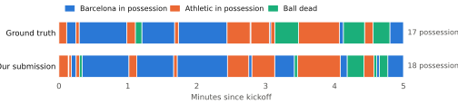

# Who Has the Ball? Recovering Ball Possession from Defective Tracking with Factorized Temporal Models

**Team NumpyWarriors**<br>
More than a Hack 2027, Phase 1<br>
<https://github.com/saaranshpandey/hackathon-2027-football>

## Abstract

We address frame-level ball possession labeling for a full professional football match: every
frame of the 25 fps tactical video must be labeled as home possession, away possession or dead
ball, given only automatic tracking data. The tracking is severely defective. The ball is
unobserved on 41% of in-play frames, and the 22 players are spread across 46 anonymous,
fragmented track slots. We propose a factorized model that separates *whether* the ball is in
play from *which team* controls it. A bidirectional temporal Transformer estimates the dead-ball
probability. The possession probability is the mean of a dilated temporal convolutional network
and PathCRF, a ball-free possession model applied to identity-stitched trajectories. A
three-state Viterbi decoder with switching costs and a two-second control rule turn frame
probabilities into possession spells. To bridge the gap between clean labeled data and the
target match, we train on public Bundesliga matches corrupted to reproduce the target tracker's
aggregate defect statistics, without using any label of the target match. On the public
five-minute window of the target match the model attains a spell F1 of 0.686 and predicts 18
possessions against 17. On two held-out corrupted German matches it attains 0.747 and 0.790.
The submission is regenerated byte for byte by a single command.

## 1 Introduction

Ball possession is the basic unit of football analysis: who had the ball, for how long, and how
each possession ended. The More than a Hack 2027 challenge asks for possession at the finest
grain, one label per video frame for a full LaLiga match between Barcelona and Athletic, using
the provided automatic tracking. Submissions are ranked by spell F1, which rewards recovering
each real possession as one contiguous spell rather than labeling individual frames correctly.

Two properties of the data make the task hard. First, the ball is missing on 41% of in-play
frames, and the gaps concentrate where possession changes: the ball is missing on 54% of frames
when players are slow, typically around stoppages and restarts, against 12% when play is
flowing. Rules that assign possession to the player nearest the ball therefore fail exactly when
they are needed. Second, the tracker does not preserve identity: 46 track slots cover 22
players, and a player's track restarts in a new slot whenever they are lost. Finally, no labels
of the target match may be used for training, and the five public minutes of ground truth are
reserved for checking the pipeline.

We make the following contributions.

- **Defect-matched training data.** We measure aggregate defect statistics of the target
  tracking and impose them on clean, labeled tracking from seven public German matches, so that
  models are trained and validated under the conditions of the target match without seeing any of
  its labels.
- **A factorized possession model.** Dead-ball and team possession are estimated by different
  temporal models and combined in a single probabilistic emission: a Transformer for dead balls,
  and the average of a temporal CNN and the ball-free PathCRF model for the team.
- **Spell-level decoding.** A Viterbi decoder with switching costs and a two-second control rule
  encode the challenge's definition of controlled possession and produce whole possessions.
- **Exact reproducibility.** All weights are released; one command regenerates the submission
  byte for byte.

Figure 1 gives an overview of the model.


*Figure 1: Model overview. Blue boxes are learned networks. The Transformer estimates whether
the ball is dead; the mean of the temporal CNN and PathCRF estimates which team has it while
play is live. A Viterbi decoder and a control rule turn the two probabilities into labels.*

## 2 Related Work

**Possession from tracking.** Rule-based methods assign individual possession from the spatial
relation between players and the ball (Link & Hoernig, 2017). They require an accurate ball
position, which our target data lacks on 41% of in-play frames.

**Ball-free inference.** Kim et al. (2023) infer the ball trajectory from player motion alone
with a Set Transformer (Lee et al., 2019) and hierarchical recurrent networks. PathCRF (Kim et
al., 2026) detects on-ball events from player trajectories by selecting, at each time step, one
edge of a dynamic player graph that represents the current possession state, with a conditional
random field (Lafferty et al., 2001) enforcing consistency over time. We use PathCRF's published
checkpoint as one of two team-possession signals.

**Temporal models and structured decoding.** We use a Transformer encoder (Vaswani et al., 2017)
and a dilated temporal convolutional network (Bai et al., 2018) over per-frame features, and
decode with the Viterbi algorithm (Viterbi, 1967), which penalizes implausible label switches in
the manner of a hidden Markov model.

**Training under distribution shift.** Domain randomization (Tobin et al., 2017) trains on
heavily perturbed simulations so that the real world appears as one more variation. Our
corruption is instead fitted to the measured defect statistics of one target tracker.

## 3 Problem Setup

Let $t = 1, \dots, T$ index video frames ($T = 199{,}319$ at 25 fps) and let $X_t$ hold the
tracked positions of all player slots and of the ball, any of which may be missing. Each graded
frame has a label $y_t \in \{H, A, D\}$: home (Barcelona) possession, away (Athletic)
possession, or dead ball. Frames outside the two halves are ungraded. We factorize the label
into a dead-ball indicator $d_t \in \{0, 1\}$ and, when the ball is live, a home-possession
indicator $h_t \in \{0, 1\}$.

**Metrics.** Spell F1 matches predicted and true possession spells one-to-one by temporal
intersection over union and averages the F1 score over IoU thresholds 0.3 to 0.7; it decides
the ranking. Macro F1 is the per-frame F1 averaged over $H$, $A$ and $D$.

**Data.** For the target match, only the tracking is used as model input. For training we use
the Sportec Open DFL Dataset (Bassek et al., 2025): seven Bundesliga and 2. Bundesliga matches
whose tracking carries per-frame ball status and possessing team, which map directly to $H$,
$A$ and $D$. We split them into five training matches, one validation match (J03WQQ) and one
test match (J03WR9).

## 4 Method

We first describe how training data is made to resemble the target match, then the features,
the factorized model, the decoder and the training procedure (Figure 1).

### 4.1 Defect-matched training data

The DFL tracking is clean, whereas the target tracking is not. We measure a set of aggregate
statistics $\theta$ on the target tracking: the share of frames with a missing ball, the length
distribution of missing-ball gaps, the rate at which gaps start in each game situation (for
example near the touchline), track-slot lifetimes, the mean number of visible players (20.5) and
the rate of identity jumps. A corruption process $S_\theta$ then anonymizes and fragments the
German tracks, hides players, swaps identities and removes the ball in gaps drawn from these
distributions, giving training inputs $\tilde{X} = S_\theta(X)$ with unchanged labels. Only
distributions are taken from the target match: no labels and no frame-specific values. As
training targets we use the DFL labels after applying the control rule of Section 4.4, so that
training and validation measure the definition we submit.

### 4.2 Features

Each frame is described by $\phi_t \in \mathbb{R}^{44}$ at 5 fps. Twenty-eight dead-ball features
cover ball visibility and speed, distance to the touchlines and corners, the length of the
current missing-ball gap, player speed statistics, the number of slow players, team spread,
players near the ball and in the penalty areas, and rolling versions over 0.5, 2 and 5 seconds.
Sixteen team features give each side's centroid, spread, mean speed, distance of its nearest
player to the ball and number of players within 10 m of it, plus the ball position. Each half is
rotated so that the home team always attacks in the same direction, and no feature crosses
halftime. Features are standardized with training statistics.

### 4.3 Factorized possession model

The model combines three networks:

$$p^{\mathrm{dead}}_t = f^{\mathrm{TF}}(\phi)_t, \qquad p^{\mathrm{home}}_t = \frac{1}{2}\left(f^{\mathrm{CNN}}(\phi)_t + f^{\mathrm{CRF}}(\tilde{Z})_t\right),$$

where $f^{\mathrm{CRF}}$ operates on stitched trajectories $\tilde{Z}$, described below. The two
probabilities define the emission of each label:

$$e_t(H) = (1 - p^{\mathrm{dead}}_t)\, p^{\mathrm{home}}_t, \qquad e_t(A) = (1 - p^{\mathrm{dead}}_t)(1 - p^{\mathrm{home}}_t), \qquad e_t(D) = p^{\mathrm{dead}}_t.$$

**Temporal Transformer** ($f^{\mathrm{TF}}$). Two pre-norm encoder layers with width 64, four
attention heads, feed-forward width 128, sinusoidal positions and dropout 0.1 (78k parameters).
It reads windows of 128 steps (25.6 s), long enough to see players walk back for a restart.
At inference, overlapping windows with stride 32 are averaged with weights and interpolated to
25 fps. Its long bidirectional context suits dead balls, which build up and resolve over
several seconds.

**Temporal CNN** ($f^{\mathrm{CNN}}$). A 1×1 input projection to 64 channels followed by six
residual blocks of kernel-3 dilated convolutions (dilations 1 to 32) with ReLU and dropout 0.1
(77k parameters), giving a receptive field of 12.6 s.

**PathCRF** ($f^{\mathrm{CRF}}$). The published checkpoint of Kim et al. (2026), used without
retraining. It expects 11 identity-continuous players per team, so we stitch the anonymous slots
into 11 + 11 columns: a slot keeps its column while visible, a new slot takes the free column
whose last known position is nearest, within running reach, and gaps are linearly interpolated.
PathCRF runs on live stretches found by a gradient-boosted dead-ball classifier (150 trees;
Pedregosa et al., 2011), and the team of its predicted possessor gives the home probability.

The CNN reasons from team-level summary features and PathCRF from player-to-player possession
paths. Their errors differ, so their mean is a steadier possession signal than either alone.

### 4.4 Decoding possessions

Within each half, the label sequence maximizes the emission likelihood minus a cost for every
change of label:

$$\hat{y}_{1:T} = \underset{y_{1:T}}{\mathrm{arg\,max}} \sum_{t} \log\, e_t(y_t) - \sum_{t > 1} c(y_{t-1}, y_t),$$

with $c(H, A) = c(A, H) = 8$, $c(s, D) = c(D, s) = 4$ for $s \in \{H, A\}$, and zero
otherwise, solved exactly by the Viterbi algorithm. Probabilities are clipped to
$[0.001, 0.999]$, and graded frames before each half's kickoff are set to dead. A frame without
team evidence ($p^{\mathrm{home}}_t \approx 0.5$) cannot pay the switching cost, so loose balls
stay with the last team in control.

A control rule then implements the challenge's notion of *controlled* possession: within a live
stretch, a spell of the other team shorter than $\tau = 50$ frames (2 s) is returned to the team
that had the ball before it, except for the first spell after a stoppage, whose team restarts
play and has the ball by definition. The threshold was fixed before any result was seen. Table 1
summarizes the resulting rules.

*Table 1: Possession rules implemented.*

| Situation | Label | Mechanism |
|---|---|---|
| Ball out of play, stoppage, before kickoff | Dead ball | Learned from DFL ball status; pre-kickoff frames forced dead |
| Loose ball, pass or cross in flight | Last team in control | Uninformative frames cannot pay the switching cost |
| Touch, deflection, lost aerial duel | No change unless the new team keeps the ball for 2 s | Control rule |
| Restart after a stoppage | Restarting team, immediately | First spell after a stoppage is always kept |
| Halftime, before and after the halves | Ungraded | Excluded from decoding |

### 4.5 Training

$f^{\mathrm{TF}}$ and $f^{\mathrm{CNN}}$ are trained with a dead-ball head and a home head on the
corrupted training matches, using

$$\mathcal{L} = \frac{1}{|\mathcal{T}|}\sum_{t \in \mathcal{T}} \mathrm{BCE}\left(p^{\mathrm{dead}}_t, d_t\right) + \frac{1}{|\mathcal{T}_{\mathrm{live}}|}\sum_{t \in \mathcal{T}_{\mathrm{live}}} \mathrm{BCE}\left(p^{\mathrm{home}}_t, h_t\right),$$

where $\mathcal{T}$ are labeled frames and $\mathcal{T}_{\mathrm{live}}$ those with a live ball.
Each match is also presented with the teams swapped and the labels flipped. The Transformer uses
AdamW (learning rate $3 \times 10^{-4}$, weight decay 0.01), batches of 128 windows, 200 steps per
epoch, gradient clipping at 1.0 and bfloat16 autocast; the CNN uses Adam (learning rate
$10^{-3}$) with batches of 16 windows of 600 steps (120 s). Both stop early on validation loss
with patience 5; the Transformer's best epoch was 14. At inference we keep the Transformer's
dead-ball head and the CNN's home head.

## 5 Experiments

**Setup.** We evaluate on the corrupted validation and test matches, scored against the DFL
labels after the control rule, and on the public five-minute window of the target match (7,500
graded frames, 17 possessions) with the organizers' scorer. The Transformer was trained and the
submission generated on one NVIDIA RTX 5070 Ti.

*Table 2: Results of the submitted model. Possessions are predicted / true counts.*

| Evaluation | Spell F1 | Macro F1 | Possessions |
|---|---:|---:|---:|
| Validation: J03WQQ, corrupted | 0.747 | 0.919 | 285 / 284 |
| Test: J03WR9, corrupted | 0.790 | 0.935 | 253 / 267 |
| Target match, public window | **0.686** | **0.796** | **18 / 17** |

**Results.** Table 2 reports the submitted model. On every match the number of predicted
possessions is within 6% of the truth: the model recovers whole possessions rather than
fragments, which is what spell F1 rewards. On the public window it reaches 0.686, against 0.424
for the best baseline provided by the organizers. Figure 2 shows that the predicted spells
follow the structure of the ground truth across the window. The model was selected on the
validation match and never tuned on the public window, which served only to check the pipeline.



*Figure 2: The public five minutes of the target match, frame by frame. Top: ground truth.
Bottom: our submission.*

## 6 Limitations

The control rule merges genuine short possessions, such as an interception lost straight back.
Stoppages inside the pitch, such as fouls and injuries, are harder to detect than a ball leaving
it, and during long missing-ball gaps the team signal rests on player movement alone. The
corrupted German matches reproduce the target tracker's defect statistics but not its exact
failure modes. Finally, the design was settled after the test match had been inspected during
development, and the published PathCRF checkpoint used our validation match for its own
checkpoint selection, so the German scores are slightly optimistic; the public window, never
used for tuning, is the cleanest estimate. Natural extensions are retraining PathCRF on our
split, self-supervised adaptation to the target match's unlabeled tracking, seed ensembles, and
ball detection from video to fill tracking gaps.

## 7 Conclusion

Possession can be recovered from tracking that loses the ball for two-fifths of play, provided
the model is trained on data with the same defects, separates dead balls from team possession,
and decodes whole possessions rather than frames. Our factorized model recovers 18 possessions
where the public window has 17, at a spell F1 of 0.686.

## Reproducibility Statement

All code, trained weights and the exact software environment are in the repository. One command
regenerates the submission, which we verified from a fresh clone. Its SHA-256 is<br>
`3f4878340177bee5d22d825d4370710567ade8d617032cf6aee54e0ac4aa20bc`.<br>
Appendix A lists the commands and Appendix B the data used.

## References

Manuel Bassek et al. An integrated dataset of spatiotemporal and event data in elite soccer.
*Scientific Data*, 2025.

Shaojie Bai, J. Zico Kolter, and Vladlen Koltun. An empirical evaluation of generic
convolutional and recurrent networks for sequence modeling. *arXiv:1803.01271*, 2018.

Hyunsung Kim et al. Ball trajectory inference from multi-agent sports contexts using set
transformer and hierarchical bi-LSTM. In *KDD*, 2023.

Hyunsung Kim et al. ELASTIC. Code repository for synchronizing soccer event and tracking data,
2025. <https://github.com/hyunsungkim-ds/elastic>.

Hyunsung Kim et al. PathCRF: Ball-free soccer event detection via possession path inference
from player trajectories. In *KDD*, 2026. arXiv:2602.12080.

John Lafferty, Andrew McCallum, and Fernando Pereira. Conditional random fields: Probabilistic
models for segmenting and labeling sequence data. In *ICML*, 2001.

Juho Lee, Yoonho Lee, Jungtaek Kim, Adam Kosiorek, Seungjin Choi, and Yee Whye Teh. Set
transformer: A framework for attention-based permutation-invariant neural networks. In *ICML*,
2019.

Daniel Link and Martin Hoernig. Individual ball possession in soccer. *PLoS ONE*, 12(7), 2017.

Fabian Pedregosa et al. Scikit-learn: Machine learning in Python. *Journal of Machine Learning
Research*, 12:2825–2830, 2011.

Josh Tobin, Rachel Fong, Alex Ray, Jonas Schneider, Wojciech Zaremba, and Pieter Abbeel.
Domain randomization for transferring deep neural networks from simulation to the real world.
In *IROS*, 2017.

Ashish Vaswani et al. Attention is all you need. In *NeurIPS*, 2017.

Andrew J. Viterbi. Error bounds for convolutional codes and an asymptotically optimum decoding
algorithm. *IEEE Transactions on Information Theory*, 13(2):260–269, 1967.

## Appendix A: Reproduction

Environment: Windows 11, Python 3.12.12, uv 0.10.6, NVIDIA RTX 5070 Ti, PyTorch 2.11.0 with
CUDA 12.8. Unpack the match bundle into `data/` as described in `data/README.md`, then:

```powershell
uv venv --python 3.12 .venv
uv pip install --python .venv/Scripts/python.exe -r requirements-submission.txt `
    --index-strategy unsafe-best-match
.venv/Scripts/python.exe -m possession.run --approach T_DBC --device cuda --post 50 `
    --name T_DBC
.venv/Scripts/python.exe evaluation/validate_submission.py submissions/T_DBC.csv
```

Use `--device cuda`: CPU arithmetic changes 111 of 199,319 frames (0.06%), with the same
public-window score. To retrain and re-score (the DFL data downloads automatically; see
`TRANSFORMER.md` for the defect profile; retrained weights are not bit-identical):

```powershell
.venv/Scripts/python.exe -m possession.deadball_model
.venv/Scripts/python.exe -m possession.nn
.venv/Scripts/python.exe -m possession.transformer --device cuda
.venv/Scripts/python.exe -m possession.evaluate --predictors T_DBC --matches J03WQQ J03WR9 `
    --labels controlled2 --post 50
```

This document is built from `SOLUTION.md` by `report/build.py`.

## Appendix B: Data and Assets

**Organizer assets.** The tactical tracking is the only model input. The two kickoff frames
published in the starter code mark the start of each half. Homography, broadcast feeds and Smart
Tagging are not used. We watched the tactical video in a local review player to debug, which the
rules allow. The public five-minute ground truth was used only to check the pipeline.

**Training data.** No labels of the provided game were used, and we created no labels ourselves.

*Table 3: Labeled data used.*

| Dataset | Labeled by | Amount | Use |
|---|---|---|---|
| Sportec Open DFL Dataset (Bassek et al., 2025; CC-BY 4.0), via the Hugging Face mirror `pysport/idsse-data` | DFL / Sportec Solutions: ball status and possessing team in the official tracking feed | 7 matches: 5 train, 1 validation, 1 test | Training the Transformer, CNN and dead-ball classifier; validation and test |
| DFL event data synchronized with ELASTIC (Kim et al., 2025), shipped with PathCRF | DFL (manual event annotation), synchronized by the PathCRF authors | Same 7 matches | Training of the published PathCRF checkpoint by its authors |
