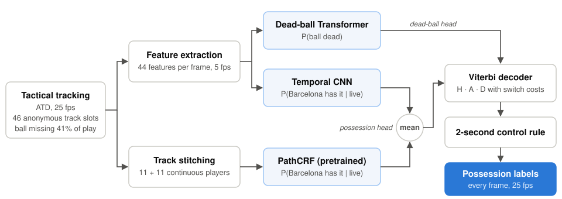

# Who has the ball? Possession from broken tracking with a hybrid temporal ensemble

**Team NumpyWarriors** · More than a Hack 2027, Phase 1 · Code:
<https://github.com/saaranshpandey/hackathon-2027-football>

| 0.686 | 18 vs 17 | 0.768 | 1 command |
|---|---|---|---|
| spellF1 on the public 5-minute window, against 0.424 for the best organiser baseline | possessions predicted vs actual in that window | mean spellF1 on two held-out German matches | regenerates the submission byte for byte from a fresh clone |

## Summary

We label every frame of Barcelona vs Athletic as Barcelona possession (H), Athletic possession
(A) or dead ball (D), from the provided tracking alone. The hard part is not the classifier but
the data: **the ball is missing on 41% of in-play frames, and players are split across 46
anonymous, fragmented track slots.** Our model rests on three ideas.

1. **Train on data that looks like this match.** Seven public German matches come with
   frame-level possession labels and clean tracking. We corrupt that tracking with the defect
   statistics of this match, so the model learns under the conditions it will face.
2. **Split the question in two.** *Is the ball dead?* and *who has it?* need different evidence,
   so different networks answer them. A temporal Transformer handles dead balls. The average of
   PathCRF, a published model that finds the ball carrier from player movement alone, and a
   temporal CNN handles the team.
3. **Decode possessions, not frames.** A Viterbi decoder and a 2-second control rule turn noisy
   per-frame probabilities into whole possessions, which is the unit the competition scores.

On the public window the model recovers 18 possessions where the truth has 17, with spellF1
0.686: 1.6 times the best organiser baseline on the same five minutes.

## 1. Why this match is hard

- **The ball disappears when it matters most.** It is missing on 41% of in-play frames: 12% when
  play is flowing, but 54% when players are slow, which is around stoppages and restarts, exactly
  where possession changes.
- **Players have no identity.** 46 track slots cover 22 players. When the tracker loses a player,
  the track restarts in a new slot. On average 20.5 players are visible.
- **There is nothing to train on.** The rules forbid labelling this match, and the five public
  minutes are for checking a pipeline, not tuning it.

So the model has to read possession largely from how players move, and it has to be trained on
data that suffers from the same problems.

## 2. The model



*Figure 1. From tracking to labels. Blue boxes are learned networks; the Transformer decides when
the ball is dead, the mean of the CNN and PathCRF decides who has it when it is live.*

### 2.1 Training data that looks like this match

The Sportec Open DFL Dataset (Bassek et al., 2025) has seven Bundesliga and 2. Bundesliga
matches with per-frame ball status and possessing team. Its tracking is clean, so we measure
**aggregate defect statistics** of the provided tracking and reproduce them on the German matches
(`possession/scramble.py`). These are the share and length distribution of missing-ball gaps,
where gaps start (for example near the touchline), track-slot lifetimes, the number of visible
players and the identity-jump rate. Tracks are then anonymised and fragmented, players hidden,
identities swapped and the ball removed in realistic gaps. Only distributions are taken from
this match: no labels and no frame-specific values. Five matches train, one validates, one tests.

### 2.2 Features

Each frame gets 44 features at 5 fps. **Dead-ball features:** ball visibility, speed, distance
to the lines and corners, length of the current missing-ball gap, player speeds, number of slow
players, team spread, players near the ball and in the boxes, plus rolling versions over 0.5, 2
and 5 seconds. **Team features:** centroid, spread, mean speed, nearest player to the ball and
players within 10 m for each side, plus ball position. Each half is rotated so Barcelona always
attacks the same way, and nothing is computed across halftime.

### 2.3 The three networks

- **Dead-ball Transformer** (`possession/transformer.py`). A two-layer bidirectional Transformer
  (width 64, 4 heads) reads 25.6-second windows, long enough to see players walk back for a
  restart. Overlapping windows are averaged and interpolated back to 25 fps. It outputs the
  probability that the ball is dead.
- **Temporal CNN** (`possession/nn.py`). Six levels of dilated residual convolutions over the same
  features, with a 12.6-second receptive field. It outputs the probability that Barcelona has the
  ball while play is live.
- **PathCRF** (Kim et al., KDD 2026; `third_party/pathcrf`). A set-attention network with a
  conditional random field that infers who holds the ball from player trajectories, without the
  ball. We use the authors' published checkpoint. It needs 11 continuous players per side, so we
  stitch the 46 anonymous slots into 11 + 11 identities (`possession/stitch.py`). It runs on live
  stretches found by a gradient-boosted dead-ball classifier and also outputs the probability
  that Barcelona has the ball.

### 2.4 Combining them

P(dead) comes from the Transformer, whose long context sees stoppages build up and resolve.
P(Barcelona | live) is the mean of the CNN and PathCRF. The two fail in different ways: the CNN
reasons from team-level summary features, PathCRF from player-to-player possession paths, so
their average is steadier than either.

### 2.5 From frames to possessions

A three-state Viterbi decoder (`possession/decode.py`) finds the most likely H / A / D sequence
in each half. Switching between teams costs 8 and entering or leaving a dead ball costs 4 (in
log-probability units), so a handful of noisy frames cannot split a possession. The control rule
below then removes team changes that never became control.

## 3. Possession rules

| Situation | Our rule | Implementation |
|---|---|---|
| Ball out of play, stoppage, before kickoff | Dead ball (D) | Learned from DFL ball status; graded frames before each kickoff are forced to D |
| Loose ball, pass or cross in flight | Stays with the last team in control | Uninformative frames cannot pay the decoder's switching cost |
| Touch, deflection, lost aerial duel | Not a change of possession: the new team must keep the ball for 2 s | `possession/controlled.py` returns shorter spells to the previous team |
| Restart after a stoppage | The restarting team has the ball immediately | The first spell after any stoppage is always kept |
| Halftime, before and after the halves | Not graded (X) | No graded frame is left as X |

The 2-second threshold was fixed before looking at any result. The same rule is applied to the
German labels, so validation measures the definition we submit.

## 4. Results

| Evaluation | spellF1 | macroF1 | Possessions predicted / actual |
|---|---:|---:|---:|
| Validation: German match J03WQQ, corrupted like this match | 0.747 | 0.919 | 285 / 284 |
| Test: German match J03WR9, corrupted like this match | 0.790 | 0.935 | 253 / 267 |
| **This match, public 5-minute window** | **0.686** | **0.796** | **18 / 17** |


*Figure 2. The public five minutes, frame by frame: ground truth above, our submission below.*

On every match the predicted number of possessions is within 6% of the truth: the model finds
whole possessions rather than fragments, which is what spellF1 rewards. It was selected on the
validation match and never tuned on the public window, which served only to check the pipeline.

## 5. Data and assets

**From the organisers.** The tactical tracking is the only model input. The two kickoff frames
from the starter code mark the start of each half. Homography, broadcast feeds and Smart
Tagging are not used. We watched the tactical video in a local review player to debug, which the
rules allow. The public 5-minute ground truth was used only to check the pipeline.

**Training data.** No labels of the provided game were used, and we created no labels ourselves.

| Dataset | Labelled by | Amount | Use |
|---|---|---|---|
| Sportec Open DFL Dataset (Bassek et al., *Scientific Data* 2025, CC-BY 4.0), via the Hugging Face mirror `pysport/idsse-data` | DFL / Sportec Solutions: ball status and possessing team in the official tracking feed | 7 Bundesliga / 2. Bundesliga matches: 5 train, 1 validation, 1 test | Training the Transformer, CNN and dead-ball classifier; validation and test |
| DFL event data synchronised with ELASTIC, shipped with PathCRF | DFL (manual event annotation), synchronised by the PathCRF authors | Same 7 matches | Training of the published PathCRF checkpoint by its authors |

## 6. Limitations and next steps

- **Quick turnovers are merged.** The 2-second rule removes genuine short possessions, such as an
  interception lost straight back.
- **Stoppages inside the pitch** (fouls, injuries) are harder to see than a ball leaving it.
- **Long missing-ball gaps** leave the team signal to player movement alone.
- **German matches are a proxy.** They copy this tracker's defect statistics, not its exact
  failure modes.
- **Evaluation caveat.** The design was settled after the test match had been inspected during
  development, and the published PathCRF checkpoint used our validation match for its own
  checkpoint selection, so the German numbers are slightly optimistic. The public window, never
  used for tuning, is the cleanest check.
- **Next steps:** retrain PathCRF on our split; adapt to this match's unlabelled tracking with
  self-supervised learning; ensemble several training seeds; detect the ball in the video to fill
  tracking gaps.

## 7. Reproduction

Built on Windows 11 with Python 3.12.12, uv 0.10.6, an NVIDIA RTX 5070 Ti and PyTorch 2.11.0
(CUDA 12.8). All trained weights are in the repository.

```powershell
uv venv --python 3.12 .venv
uv pip install --python .venv/Scripts/python.exe -r requirements-submission.txt --index-strategy unsafe-best-match
# unpack the match bundle into data/ (see data/README.md), then:
.venv/Scripts/python.exe -m possession.run --approach T_DBC --device cuda --post 50 --name T_DBC
.venv/Scripts/python.exe evaluation/validate_submission.py submissions/T_DBC.csv
```

The output `submissions/T_DBC.csv` has SHA-256
`3f4878340177bee5d22d825d4370710567ade8d617032cf6aee54e0ac4aa20bc`. We regenerated it byte for
byte from a fresh clone. Use `--device cuda`: CPU arithmetic changes 111 of 199,319 frames
(0.06%), with the same public-window score.

To retrain and re-score (downloads the DFL data automatically; see `TRANSFORMER.md` for the
defect profile). Retrained weights are not bit-identical to the committed ones.

```powershell
.venv/Scripts/python.exe -m possession.deadball_model
.venv/Scripts/python.exe -m possession.nn
.venv/Scripts/python.exe -m possession.transformer --device cuda
.venv/Scripts/python.exe -m possession.evaluate --predictors T_DBC --matches J03WQQ J03WR9 `
    --labels controlled2 --post 50
```

This report is built from `SOLUTION.md` by `report/build.py`.
